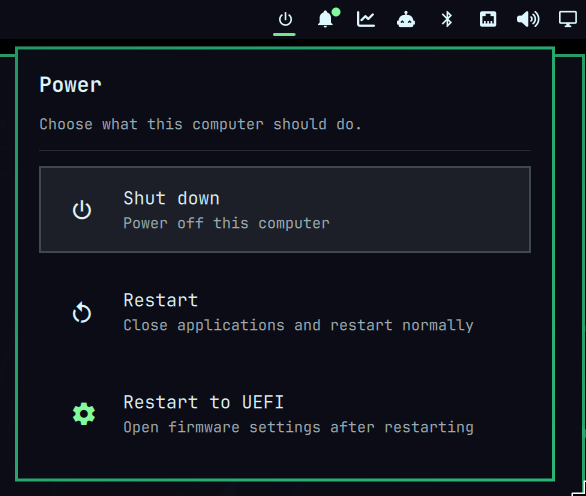

# Omarchy Power Actions

A theme-aware power menu for the Omarchy Shell bar. It provides quick access
to:

- Shut down
- Restart
- Restart into UEFI firmware settings

Every action asks for confirmation before it runs. The menu supports both
mouse and keyboard navigation and uses the active Omarchy theme.



## Requirements

- A current installation of [Omarchy](https://omarchy.org/)
- Omarchy Shell with plugin support
- A system whose firmware supports rebooting into UEFI setup for the UEFI
  action

## Installation from GitHub

```bash
omarchy plugin add https://github.com/Johnathicc/omarchy-bios-plugin.git --enable
```

The `--enable` option adds the widget to the bar as part of installation.
Omarchy Shell should discover and load it automatically.

If the plugin was installed without `--enable`, enable it separately:

```bash
omarchy plugin enable siob.power-actions --section right
```

To confirm that Omarchy discovered it:

```bash
omarchy plugin list
```

## Local installation

Use this method when testing a local checkout instead of installing from
GitHub:

```bash
mkdir -p ~/.config/omarchy/plugins/siob.power-actions
cp Panel.qml manifest.json ~/.config/omarchy/plugins/siob.power-actions/
omarchy plugin enable siob.power-actions --section right
```

Run these commands from the root of this repository. Files saved under
`~/.config/omarchy/plugins/` are normally hot-reloaded by Omarchy Shell.

## Usage

Select the power icon in the bar, then choose an action. The menu supports:

- Mouse hover and click
- Arrow keys to move between actions
- Enter to select and confirm
- Escape to cancel or close the menu

The UEFI action runs:

```bash
systemctl reboot --firmware-setup
```

Whether that action works depends on the computer's firmware and systemd
support.

## Updating

For a plugin installed from GitHub:

```bash
omarchy plugin update siob.power-actions --yes
```

For a local installation, copy the updated files into the plugin directory
again:

```bash
cp Panel.qml manifest.json ~/.config/omarchy/plugins/siob.power-actions/
```

## Troubleshooting

Validate the plugin manifest:

```bash
omarchy plugin validate ~/.config/omarchy/plugins/siob.power-actions
```

If changes do not appear after a few seconds, restart Omarchy Shell:

```bash
omarchy restart shell
```

## Uninstallation

See [UNINSTALL.md](UNINSTALL.md) for complete removal instructions.
